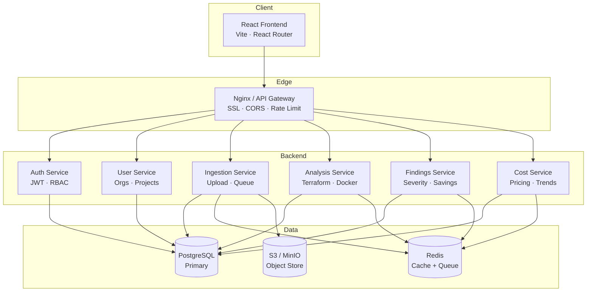
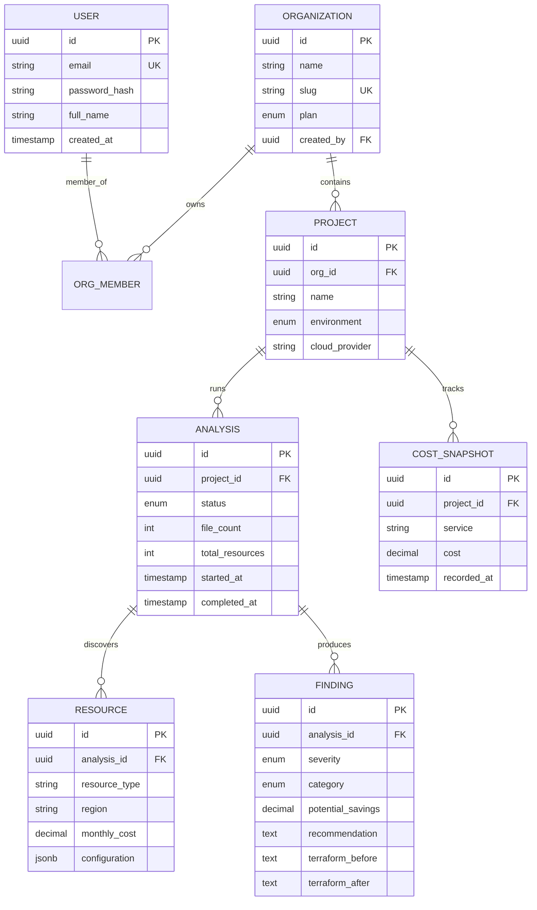
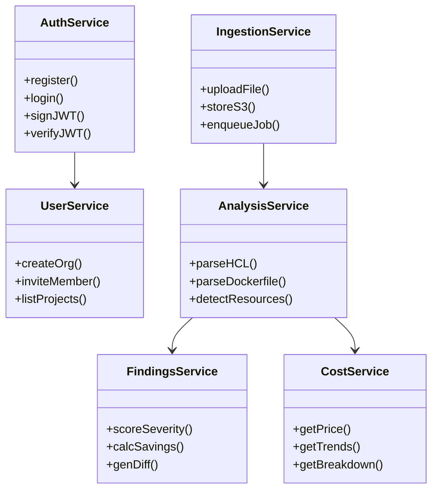
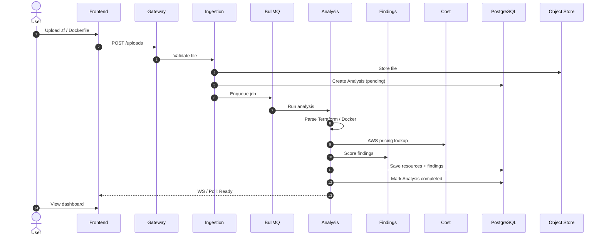

# OptiCloud — Backend Design Notes

**Project:** OptiCloud · AI Cloud Cost & Architecture Optimizer  
**Tagline:** Understand. Optimize. Scale.  
**Team:** Naman (Backend Lead) · Dhruv (Full Stack)  
**Focus:** Backend system design (HLD + LLD)

---

## 1. One-Liner
Read-only analysis of Terraform / Docker configs + AWS cost data → severity-scored findings → AI recommendations, never auto-deploy.

---

## 2. High Level Design (HLD)

### System Architecture



### Service Responsibilities

| Service | Does |
|---------|------|
| **Auth** | JWT access/refresh, bcrypt, org-scoped RBAC |
| **User** | Users, organizations, project membership |
| **Ingestion** | File upload → S3 → enqueue analysis job |
| **Analysis** | Parse HCL/Dockerfile, detect resources |
| **Findings** | Score severity, calculate savings, generate diffs |
| **Cost** | AWS pricing, cost trends, breakdown by service |

---

## 3. Low Level Design (LLD)

### Database Schema (PostgreSQL)



### Module Design



---

## 4. API Summary

| Domain | Endpoints | Auth |
|--------|-----------|------|
| **Auth** | `POST /auth/login`, `POST /auth/register`, `GET /auth/me` | Public / JWT |
| **Orgs** | `GET /organizations`, `POST /organizations`, `POST /organizations/:slug/members` | JWT |
| **Projects** | `GET /orgs/:slug/projects`, `POST /orgs/:slug/projects`, `GET /projects/:id` | JWT |
| **Uploads** | `POST /projects/:id/uploads`, `GET /uploads/:id` | JWT |
| **Analyses** | `GET /projects/:id/analyses`, `GET /analyses/:id`, `POST /analyses/:id/re-run` | JWT |
| **Findings** | `GET /analyses/:id/findings`, `PATCH /findings/:id` | JWT |
| **Costs** | `GET /projects/:id/costs`, `GET /projects/:id/savings` | JWT |

---

## 5. Backend Folder Structure

```
Backend/
├── src/
│   ├── index.js           # Entry
│   ├── config.js          # Env, DB, Redis
│   ├── app.js             # Express setup
│   │
│   ├── middleware/
│   │   ├── auth.js        # JWT + RBAC
│   │   ├── cors.js
│   │   └── errorHandler.js
│   │
│   ├── routes/
│   │   ├── auth.js
│   │   ├── orgs.js
│   │   ├── projects.js
│   │   ├── uploads.js
│   │   ├── analyses.js
│   │   ├── findings.js
│   │   └── costs.js
│   │
│   ├── controllers/       # Route handlers
│   ├── services/          # Biz logic (auth, ingestion, analysis, findings, cost)
│   ├── models/            # DB schemas (User, Org, Project, Analysis, Resource, Finding, Cost)
│   ├── utils/             # db.js, redis.js, queue.js, s3.js, logger.js
│   ├── jobs/              # analysisJob.js (BullMQ worker)
│   └── migrations/        # .sql files
│
├── package.json
├── .env.example
├── Dockerfile
└── docker-compose.yml
```

---

## 6. Data Flow — Analysis Pipeline



---

## 7. Security & Auth

- **JWT** access (15m) + refresh (7d) tokens
- **RBAC:** Owner / Admin / Member / Viewer
- **Org-scoped queries:** Users see only their org's data
- **Bcrypt** password hashing
- **CORS:** Restricted to frontend origin
- **Zod:** Request validation on all endpoints

---

## 8. Team Split

| Member | Owns |
|--------|------|
| **Naman** | Backend APIs, Auth, DB, Ingestion, Analysis, Findings, Cost services |
| **Dhruv** | Frontend UI, API consumption, Dashboard, Deployment |

---

## 9. Quick Start (Backend)

```bash
cd Backend
npm install
cp .env.example .env
npm run migrate
npm run dev        # nodemon on :5000
```

**Stack:** Node.js + Express + PostgreSQL + Redis + BullMQ + AWS S3 + JWT

---

*OptiCloud — Catch the waste before it ships.*